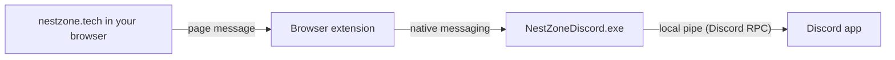

<div align="center">


# NestZone for Discord

Shows what you watch and read on [NestZone](https://nestzone.tech) in your Discord status, with the cover, the episode or chapter and a progress bar.

[](https://github.com/Aelshi-nui/NestZone-Rpc/releases/latest)
[](https://github.com/Aelshi-nui/NestZone-Rpc/releases)
[](https://github.com/Aelshi-nui/NestZone-Rpc/actions/workflows/release.yml)


[-5865F2?style=for-the-badge&logo=discord&logoColor=white)](https://github.com/Aelshi-nui/NestZone-Rpc/releases/latest/download/NestZoneDiscord.exe)
[](https://github.com/Aelshi-nui/NestZone-Rpc/releases/latest/download/nestzone-discord-chrome.zip)
[](https://github.com/Aelshi-nui/NestZone-Rpc/releases/latest/download/nestzone-discord-firefox.zip)

</div>

## What it shows

| When you're | Discord shows |
| --- | --- |
| Watching | **Watching NestZone** with the show, the episode and its name, sub or dub, the cover and a progress bar |
| Reading | **Playing NestZone** with "Reading" and the title, the chapter and page, the cover and how long you've been reading |

Each status has a **Watch now** or **Read now** button that opens the episode or title on NestZone, and a **NestZone** button that opens the site. The title and the cover link to AniList. 18+ titles only show when you turn that on, and always without their cover.

## How it works

A website can't talk to the Discord app on your PC by itself, so this has two small parts:



| Part | What it does |
| --- | --- |
| **Extension** | Runs only on `https://nestzone.tech`. It reads what the player or reader is showing and passes it on. |
| **Helper** (`NestZoneDiscord.exe`) | A tiny Windows program the browser starts when needed. It sends the status to the Discord app through Discord's local pipe. It has no network code. |

> [!NOTE]
> Everything stays on your PC. The helper only talks to your browser and to the Discord app that is already running. Nothing is sent to NestZone or anywhere else.


## Before you start

| You need | Notes |
| --- | --- |
| Windows 10 or 11 | The helper is a Windows program. Phones can't show a Discord status. |
| The Discord **desktop app** | Discord in a browser tab can't receive a status. Keep the app open while you watch. |
| Chrome, Edge, Brave or Firefox | Use it on this same PC. |

In Discord, **User Settings > Activity Privacy > Share my activity** has to be on.

## Set it up

### Step 1: Install the helper

1. Download [**NestZoneDiscord.exe**](https://github.com/Aelshi-nui/NestZone-Rpc/releases/latest/download/NestZoneDiscord.exe) from the latest release.
2. Double-click it. It sets itself up for your Windows user and shows **"NestZone for Discord is set up."** Click **OK**.

> [!IMPORTANT]
> The helper is not signed with a paid certificate yet, so Windows SmartScreen may say **"Windows protected your PC"**. Click **More info**, then **Run anyway**. You can check the file is the one built here first, see [Check your download](#check-your-download).

It needs no admin rights. It copies itself to `%LOCALAPPDATA%\NestZone\Discord` and registers itself with Chrome, Edge, Brave, Chromium and Firefox. You can delete the downloaded file afterwards.

### Step 2: Add the extension

<details open>
<summary><b>Chrome, Edge or Brave</b></summary>

1. Download [**nestzone-discord-chrome.zip**](https://github.com/Aelshi-nui/NestZone-Rpc/releases/latest/download/nestzone-discord-chrome.zip).
2. Right-click the zip, choose **Extract All** and extract it to a folder you'll keep, for example `Documents\NestZone for Discord`. The browser loads it from there, so don't delete that folder.
3. Open the extensions page:
   - Chrome: `chrome://extensions`
   - Edge: `edge://extensions`
   - Brave: `brave://extensions`
4. Turn on **Developer mode** (top right in Chrome and Brave, left side in Edge).
5. Click **Load unpacked** and pick the folder you extracted (the one with `manifest.json` in it).
6. Click the puzzle icon in the toolbar and pin **NestZone for Discord**.

The extension ID is always `fkpdelihmdmckifbemjjfpblaoingmen`. The helper only answers this ID.

</details>

<details>
<summary><b>Firefox</b></summary>

1. Download [**nestzone-discord-firefox.zip**](https://github.com/Aelshi-nui/NestZone-Rpc/releases/latest/download/nestzone-discord-firefox.zip).
2. Open `about:debugging#/runtime/this-firefox`.
3. Click **Load Temporary Add-on...** and pick the zip.

> [!WARNING]
> Firefox removes temporary add-ons when it closes, so you redo step 3 after each restart. It stays installed only once the add-on is signed by Mozilla, or in Firefox Developer Edition or Nightly with `xpinstall.signatures.required` set to `false` in `about:config`.

</details>

### Step 3: Check it works

1. Open the Discord app.
2. Open [nestzone.tech/account](https://nestzone.tech/account). The **Discord status** card should say **Connected as** and your Discord name. The extension's toolbar popup says the same.
3. Play any episode or open a chapter. Your Discord status updates within a few seconds.

- [ ] Helper installed
- [ ] Extension loaded and pinned
- [ ] Discord app open
- [ ] nestzone.tech/account says **Connected as ...**


## Settings

| Where | What you can change |
| --- | --- |
| Extension popup | **Show on Discord** turns everything off or on for this browser. |
| [nestzone.tech/account](https://nestzone.tech/account) > **Discord status** | **Show what I'm reading** and **Show 18+ titles**. |

The status clears by itself about 45 seconds after you close the player or reader, and 10 minutes after you pause.

## Check your download

Every release is built from this repository by [GitHub Actions](https://github.com/Aelshi-nui/NestZone-Rpc/actions/workflows/release.yml). Each one comes with a `SHA256SUMS.txt` file and a signed build provenance attestation, which proves the file came from this source code and was not changed afterwards.

Compare the checksum in PowerShell, in the folder you downloaded to:

```powershell
Get-FileHash .\NestZoneDiscord.exe -Algorithm SHA256
```

The hash must match the line for `NestZoneDiscord.exe` in `SHA256SUMS.txt`.

Or verify the attestation with the [GitHub CLI](https://cli.github.com):

```powershell
gh attestation verify .\NestZoneDiscord.exe --repo Aelshi-nui/NestZone-Rpc
```

## Uninstall

1. Remove the extension on the browser's extensions page.
2. Open **Settings > Apps > Installed apps**, find **NestZone for Discord** and click **Uninstall**.

   Or run this in PowerShell:

   ```powershell
   & "$env:LOCALAPPDATA\NestZone\Discord\NestZoneDiscord.exe" --uninstall
   ```

This removes the helper folder and its registry entries under `HKEY_CURRENT_USER`.

## If something goes wrong

<details>
<summary>The popup or the site says "Helper not installed"</summary>

Run `NestZoneDiscord.exe` again (step 1), then reload the extension on the extensions page. If you moved to a different Windows user, install it for that user too.

</details>

<details>
<summary>It says "Discord app is not open"</summary>

Start the Discord desktop app and wait until it has fully loaded, then reload the NestZone page. Discord in a browser tab doesn't work.

</details>

<details>
<summary>It says Connected but nothing shows in Discord</summary>

- In Discord, check **User Settings > Activity Privacy > Share my activity**.
- Check the **Show on Discord** switch in the extension popup.
- Reading only shows when **Show what I'm reading** is on at nestzone.tech/account.

</details>

<details>
<summary>Reading the helper's log</summary>

The helper writes a short log of connection events to the file below. It includes your Discord name but never what you watch or read.

```
%LOCALAPPDATA%\NestZone\Discord\helper.log
```

It's useful when you [open an issue](https://github.com/Aelshi-nui/NestZone-Rpc/issues).

</details>

## Privacy and security

- The extension asks for only two permissions, `nativeMessaging` and `storage`, and runs only on `https://nestzone.tech`.
- It accepts messages only from its own content script in a nestzone.tech tab and from its own popup.
- The helper only answers this extension's ID, has no network code, needs no admin rights and loads system DLLs from `System32` only.
- Buttons in your status can only link to `https://nestzone.tech`. The title and cover link to `https://anilist.co`.

See [SECURITY.md](SECURITY.md) for the full review and how to report a problem.

## Build from source

You need Windows with .NET Framework 4.8 (built in on Windows 10 and 11) and [Node.js](https://nodejs.org) 18 or newer. Nothing else is downloaded.

```powershell
git clone https://github.com/Aelshi-nui/NestZone-Rpc.git
cd NestZone-Rpc
powershell -ExecutionPolicy Bypass -File .\build-helper.ps1
node build-extension.mjs
```

| Output in `dist` | What it is |
| --- | --- |
| `NestZoneDiscord.exe` | The helper |
| `chrome\` and `nestzone-discord-chrome.zip` | The extension for Chrome, Edge and Brave |
| `firefox\` and `nestzone-discord-firefox.zip` | The extension for Firefox |

<details>
<summary>Signing the helper</summary>

`build-helper.ps1` signs the exe with Authenticode when a code-signing certificate is available:

```powershell
$env:NZ_SIGN_THUMBPRINT = '<certificate thumbprint from Cert:\CurrentUser\My>'
powershell -ExecutionPolicy Bypass -File .\build-helper.ps1
```

It needs `signtool.exe` from the Windows SDK. In GitHub Actions, add the certificate as the repository secrets `SIGN_CERT_PFX` (the `.pfx` file as base64) and `SIGN_CERT_PASSWORD`, and every release is signed automatically.

</details>

<details>
<summary>Making a release</summary>

Push a version tag. The [Release workflow](.github/workflows/release.yml) builds everything, writes `SHA256SUMS.txt`, attests the files and publishes the release.

```powershell
git tag v1.0.2
git push origin v1.0.2
```

Keep the version in `extension/manifest.json`, `helper/Program.cs` and `helper/AssemblyInfo.cs` the same as the tag.

</details>

## Project layout

| Path | What's in it |
| --- | --- |
| [`extension/`](extension) | The browser extension (Manifest V3) |
| [`helper/`](helper) | The Windows helper in C# |
| [`build-extension.mjs`](build-extension.mjs) | Builds the Chrome and Firefox extension |
| [`build-helper.ps1`](build-helper.ps1) | Builds and optionally signs the helper |
| [`extension-key.pub.txt`](extension-key.pub.txt) | Public key that fixes the Chrome extension ID |
| [`.github/workflows/release.yml`](.github/workflows/release.yml) | Builds and publishes releases |
